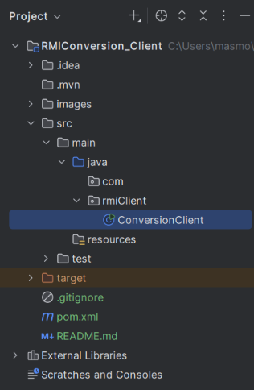
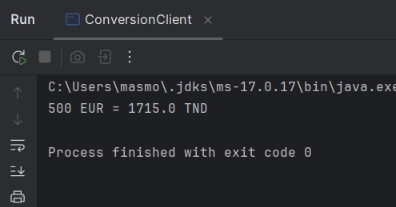
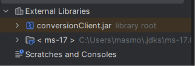

# RMIConversion_Client

Projet **client** du TP5 – Activité 5-1 (Développement d'Applications Réparties).
Il appelle à distance le service de conversion de devise (euro → dinar tunisien) publié par `RMIConversion_Server`.

## Rôle
- Se connecter au registre RMI via JNDI.
- Retrouver l'objet distant `converBank` (on obtient un stub local).
- Appeler `convertirMontant(500)` comme une méthode locale et afficher le résultat.

Le client **ne contient aucune classe du serveur** : il utilise uniquement l'interface `IConversion`, fournie par `conversionClient.jar`.

## Structure



## Prérequis
- `conversionClient.jar` (généré depuis le projet serveur, contient uniquement `rmiService/IConversion.class`) ajouté aux dépendances du projet :
  IntelliJ → File → Project Structure → Modules → Dependencies → + → JARs or Directories.
- Le serveur doit être démarré avant le client.

## Fichier jndi.properties
```
java.naming.factory.initial = com.sun.jndi.rmi.registry.RegistryContextFactory
java.naming.provider.url = rmi://localhost:1099
```
Si le serveur est sur une autre machine, remplacer `localhost` par son adresse IP.

## Exécution
1. Lancer d'abord `rmiServer.ConversionServer` (projet serveur).
2. Lancer `rmiClient.ConversionClient`.

Résultat attendu (taux 1 EUR = 3.43 TND) :
```
Résultat de la conversion : 1715.0 TND
```
Voici la capture:



## Captures d'écran
> Ajout du jar au classpath :




